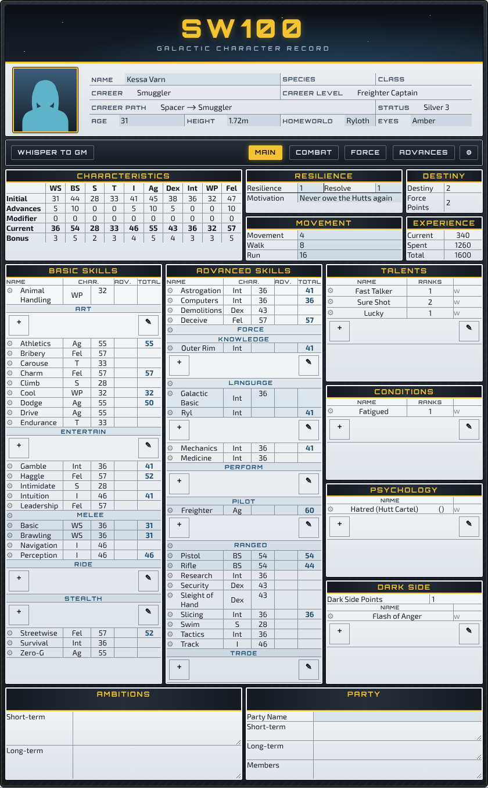

# SW100 Character Sheet for Roll20

A Roll20 character sheet for **SW100**, a Star Wars inspired d100 roleplaying game.

The layout, panel structure and sheetworker engine come from the
[Warhammer Fantasy Roleplay 4e Official sheet](https://github.com/Roll20/roll20-character-sheets/tree/master/Warhammer%20Fantasy%20Roleplay%204e%20Official).
The game content and visual theme have been replaced: it uses a gunmetal console frame,
datapad panels, Orbitron and Exo 2 type, and a signal-yellow accent. None of the
WFRP artwork is used.



## What's on the sheet

| Tab | Contents |
| --- | --- |
| **Main** | Character portrait (the avatar from the Bio & Info tab), Characteristics, Resilience/Resolve, Destiny & Force Points, Movement, Experience, Basic and Advanced Skills, Talents, Conditions, Psychology, Dark Side, Ambitions, Party |
| **Combat** | Gear, Encumbrance, Wealth (Credits / Bank / Debt), d100 hit-location Armour Points, quick-roll Controls, Advantage, Wounds, Critical Wounds, Armour, Weapons |
| **Force** | Force Powers (rolled against Force: Control, Sense or Alter) and Conflict |
| **Advances** | Careers with four levels, species skills and talents, XP awards and spends |
| **Settings** | Custom modifiers, non-career advances, roll options |
| **NPC** | A compact stat-block view (toggle **NPC** in Settings) |

Rolls use the d100 roll-under engine from the WFRP sheet: difficulty query, bonuses,
Advantage, Success Levels, automatic success and failure, and hit locations. All of
this goes to a themed roll template.

### How WFRP 4e maps to SW100

| WFRP 4e | SW100 | Attribute (for macros) |
| --- | --- | --- |
| Fate / Fortune | Destiny / Force Points | `fate` / `fortune` |
| Corruption & Mutations | Dark Side Points & taints | `corruption_points`, `repeating_corruption` |
| Spells & Prayers, Sin | Force Powers, Conflict | `repeating_spells`, `sin` |
| Channelling (winds of magic) | Force (Control / Sense / Alter / Custom) | `control`, `sense`, `alter`, `custom` |
| GC / SS / BP | Credits / Bank / Debt | `credits`, `bank`, `debt` |
| Trappings | Gear | `repeating_trappings` |
| Hair | Homeworld | `homeworld` |

The characteristics stay the same: WS, BS, S, T, I, Ag, Dex, Int, WP, Fel.

**Skills.** Basic: Animal Handling, Art, Athletics, Bribery, Carouse, Charm, Climb, Cool,
Dodge, Drive, Endurance, Entertain, Gamble, Haggle, Intimidate, Intuition, Leadership,
Melee, Navigation, Perception, Ride, Stealth, Streetwise, Survival, Zero-G.
Advanced: Astrogation, Computers, Deceive, Demolitions, Force, Knowledge, Language,
Mechanics, Medicine, Perform, Pilot, Ranged, Research, Security, Sleight of Hand,
Slicing, Swim, Tactics, Track, Trade.

**Weapon groups.** Melee: Basic, Brawling, Lightsaber, Vibroweapon, Parry, Polearm,
Two-Handed, Stun. Ranged: Pistol, Rifle, Heavy, Gunnery, Exotic, Entangling,
Explosives, Throwing.

**Species.** Human, Bothan, Duros, Mon Calamari, Rodian, Trandoshan, Twi'lek,
Wookiee, Zabrak and Droid. A Custom option is also available. Picking a species
fills in Destiny, Resilience, Movement and Size, plus starter species skills and
talents. These presets are placeholders. Edit `species_presets` in
`src/js/sheetworkers.js` to match your rules.

The WFRP sheet loaded species and talent data from the WFRP compendium.
SW100 has no compendium, so that drag-and-drop code has been removed.

## Building

The sheet is written in Pug and SCSS and compiled to `sw100.html` and `sw100.css`.
Upload those two files to Roll20, along with `translation.json`.

```bash
npm install
npm run build     # compile once, then run the consistency checks
npm start         # watch mode while editing
```

`npm run build` finishes by running `scripts/check.js`. It fails if any of these drift apart:

- the skill and specialisation lists, which live in three places:
  - `src/pug/abstracts.pug`
  - `src/js/sheetworkers.js` (the `sw` object)
  - `src/scss/_abstracts.scss`
- the `data-i18n` keys used in the HTML and the entries in `translation.json`. Roll20
  shows a blank label for any key that has no translation.

It also fails if any Roll20-hosted WFRP artwork is referenced.

To add or rename a skill, update all three lists and add the label to
`translation.json`. Then run `npm run build`.

### Installing in Roll20

Custom sheets need a Pro subscription on the game creator's account.

1. Run `npm run build`. Upload the **generated** files, not anything in `src/`.
2. In the game, open **Settings → Game Settings**, set **Character Sheet Template**
   to **Custom**, and paste:
   - the whole of `sw100.html` into the **HTML Layout** tab
   - the whole of `sw100.css` into the **CSS Styling** tab
   - the whole of `translation.json` into the **Translation** tab
3. Click **Save Changes**, then close and reopen any open character sheets.

The build writes the `sheet-` class prefix and fallback label text into the
HTML, so the sheet styles correctly whether **Legacy Sanitization** is on or
off. If it still looks unstyled, check that the CSS tab contains `sw100.css`
starting with `@import url("https://fonts.googleapis.com/...")`, and that the
HTML tab contains `sw100.html` (its first line is a hidden `attr_sheet_version`
input).

### Previewing without Roll20

```bash
node scripts/preview.js            # screenshots of every tab, the NPC view and a roll card -> screenshots/
node scripts/preview.js --preview-png   # regenerate preview.png
```

The preview script mimics how Roll20 renders a sheet: it adds the `sheet-` class
prefix, fills in translations and expands repeating sections. Sheetworkers do not
run, so derived values come from sample data. It needs Playwright with Chromium.

## Adding your own artwork

The theme is pure CSS by default. You can add images without touching the
layout code: set any variable in `src/scss/_art.scss` to an image URL in quotes,
then run `npm run build`. Variables left as `null` keep the CSS look.

| Variable | Where it shows | Suggested size |
| --- | --- | --- |
| `$sw-art-logo` | Title image; replaces the "SW100" text | 600×150 transparent PNG |
| `$sw-art-header-background` | Backdrop behind the title | 840×110 |
| `$sw-art-frame-background` | Texture for the dark frame | 256×256, tileable |
| `$sw-art-panel-background` | Texture for the light panels (keep it pale) | 512×512, tileable |
| `$sw-art-armour-figure` | Figure behind the hit locations on the Combat tab | 230×330 transparent PNG |
| `$sw-art-npc-banner` | Banner behind the NPC name and stats | 840×200 |
| `$sw-art-rollcard-banner` | Strip at the top of roll cards | 300×40 |

A relative path such as `"art/logo.png"` (relative to the repo root) works in
`scripts/preview.js`. Use that while designing. Roll20 can't read files from
your computer, so before uploading the CSS, switch each value to an `https://`
URL: an image uploaded to your Roll20 art library, or a raw GitHub link.

## Source layout

```
src/pug/sw100.pug          entry point (hidden attributes, layout includes, roll templates, workers)
src/pug/abstracts.pug      game data: header fields, characteristics, skills, wealth
src/pug/layout/            pc.pug, npc.pug, settings.pug
src/pug/components/        mixins for skills, characteristic columns and repeating rows
src/pug/rolls.pug          roll macro builders
src/pug/rolltemplates.pug  the sw roll template
src/scss/_abstracts.scss   colour tokens and the skill lists used by show/hide rules
src/scss/styling/          theme (panels, header, navigation, grids)
src/js/sheetworkers.js     calculations: characteristics, skills, careers, XP, armour, Force powers
scripts/                   build check and preview tooling
```

## Licence

The original material in this repository is released under CC0 (see `LICENSE`).
The code adapted from the Roll20 WFRP 4e Official sheet is MIT-licensed (see
`THIRD_PARTY_LICENSE.md`). Star Wars is a trademark of Lucasfilm. This is an
unofficial fan project and is not affiliated with or endorsed by Lucasfilm,
Cubicle 7 or Games Workshop.
